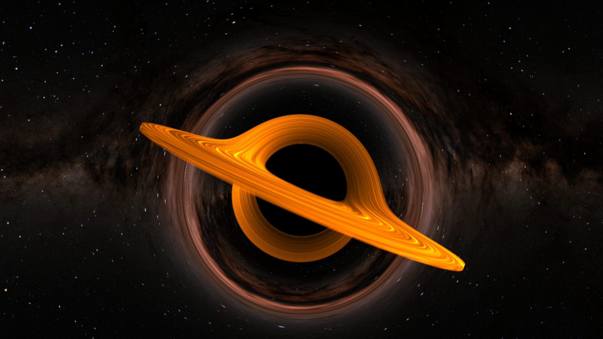

# Black Hole Ray Marcher

This project implements a real-time black hole visualization using C++ and Vulkan compute shaders. Gravitational lensing is simulated by progressively bending rays toward a black hole, while rendering a volumetric accretion disk using ray marching, procedural noise, light scattering, and absorption. The scene also includes a cubemap skybox that is distorted by the gravitational bending of rays.



## Requirements

- C++20 compatible compiler (MSVC on Windows)
- CMake 3.20+
- Vulkan SDK (Vulkan 1.3)
- Vulkan 1.3-compatible GPU
- GLFW 3.4 (via CMake FetchContent)
- GLM 1.0.3

## Setup Instructions

1. Clone the repository and navigate to the project root directory.
2. Configure and build the project using CMake:

   ```bash
   cmake -S . -B build
   cmake --build build --config Release
   ```

3. Run the generated executable.

## Features

- Ray marching using Vulkan compute shaders
- Gravitational ray bending to approximate gravitational lensing
- Volumetric accretion disk defined using SDFs
- Volumetric lighting with absorption and forward anisotropic scattering
- Adaptive ray-marching step sizes achieving a ~2.2x framerate improvement
- Interactive FPS style camera and gravitationally distorted cubemap skybox

## Ray Marching and Gravitational Lensing

Each compute shader invocation is responsible for calculating the color of a single pixel. A ray is generated using the camera's position, orientation, and an imaginary image plane.

Unlike traditional ray marching, where rays travel in straight lines, the direction of each ray is continuously adjusted toward the black hole. The gravitational bending is approximated using an inverse square relationship based on the ray's distance from the black hole.

If a ray enters the black hole's event horizon, it returns black. Otherwise, the ray can pass through the accretion disk, accumulating color and absorption, before eventually sampling the skybox.

This produces the gravitational lensing effect, including the apparent wrapping of the accretion disk around the black hole and the distortion of the background stars.

## Accretion Disk

The accretion disk is represented using a hollow cylinder SDF, allowing the shader to determine whether a ray is inside or outside the disk.

Instead of treating the disk as a solid surface, it is rendered as a volumetric medium. A density function is evaluated at positions along the ray, with each sample contributing to the disk's appearance.

The disk is tilted using a model matrix, allowing its orientation to be controlled independently of the camera.

## Procedural Noise

The accretion disk uses procedural 3D value noise to generate variations in density. The noise is generated by hashing the corners of a 3D grid cell and interpolating between them.

Multiple octaves of noise are combined using fractal Brownian motion (FBM) to produce more complex patterns.

The radial effect of the accretion disk is animated over time using an orbital speed approximation that varies with distance from the black hole.

The resulting coordinates are mapped back into a continuous 3D noise domain, avoiding discontinuities around the angular boundary.

## Volumetric Lighting

Lighting is calculated by performing a secondary ray march from points inside the accretion disk toward a directional light source.

The accumulated density along this secondary ray determines how much light reaches the current sample. Beer-Lambert's law is used to approximate absorption and transmittance through the medium.

The Henyey-Greenstein phase function is used to approximate forward anisotropic scattering, allowing the disk's appearance to vary based on the angle between the viewing direction and the light direction.

As rays travel through the disk, their accumulated transmittance also determines how much of the background skybox remains visible.

## Adaptive Ray Marching

To improve performance, the shader adjusts its ray-marching step size based on the distance to the accretion disk.

Larger steps are taken when the ray is far from the disk, while smaller steps are used when approaching or traveling through it. Step sizes are also limited near the black hole to reduce inaccuracies in gravitational bending.

This reduces unnecessary calculations through empty space while preserving detail around important parts of the scene.

## Camera Controls

The camera uses a transformation matrix to represent its position and orientation in world space. Mouse movement controls pitch and yaw, allowing the user to look around the scene.

| Key | Action |
|---|---|
| `W` / `S` | Move forward / backward |
| `A` / `D` | Move left / right |
| `Space` / `Left Control` | Move up / down |
| `Escape` | Close application |

## References

- [NASA Scientific Visualization Studio - Black Hole Visualization](https://svs.gsfc.nasa.gov/4851/)
- [Vulkan Adventures - Cube Map Tutorial](https://satellitnorden.wordpress.com/2018/01/23/vulkan-adventures-cube-map-tutorial/)
- [Rodrigo Gonzalez - Using Raymarching to create a Black Hole](https://youtu.be/dMohMW29gSM)
- [Maxime Heckel - A Gentle Study of Raymarching](https://blog.maximeheckel.com/posts/painting-with-math-a-gentle-study-of-raymarching/)
- [Maxime Heckel - Real-Time Cloudscapes with Volumetric Raymarching](https://blog.maximeheckel.com/posts/real-time-cloudscapes-with-volumetric-raymarching/)
- [Inigo Quilez - Domain Warping](https://iquilezles.org/articles/warp/)
- [Inigo Quilez - Fractal Brownian Motion](https://iquilezles.org/articles/fbm/)